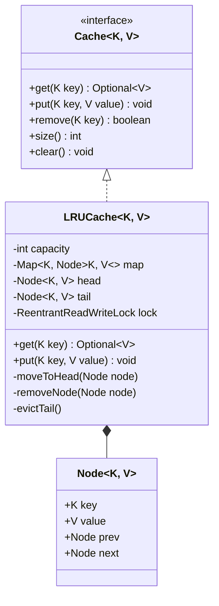

# 01 - In-Memory LRU Cache

## 🎯 Problem Statement
Design an in-memory Key-Value Cache with a fixed capacity that implements the **Least Recently Used (LRU)** eviction policy:
* `get(K key)`: Returns the value associated with the key if present, otherwise returns `Optional.empty()`. Accessing a key moves it to the most recently used position. $O(1)$ time complexity.
* `put(K key, V value)`: Updates or inserts the key-value pair. If capacity is exceeded, evicts the least recently used key. $O(1)$ time complexity.
* Must be **thread-safe** for concurrent read and write operations.

---

## 🏗 Class Diagram

---

## 🚀 Key Implementation Highlights
1. **Doubly-Linked List + HashMap**: Provides $O(1)$ lookup via the HashMap and $O(1)$ node insertion/removal via the Doubly-Linked List.
2. **Generic Implementation `<K, V>`**: Agnostic to specific data types.
3. **Thread Safety**: Uses `ReentrantReadWriteLock` to allow multiple concurrent readers while ensuring mutual exclusion for writes and evictions.
