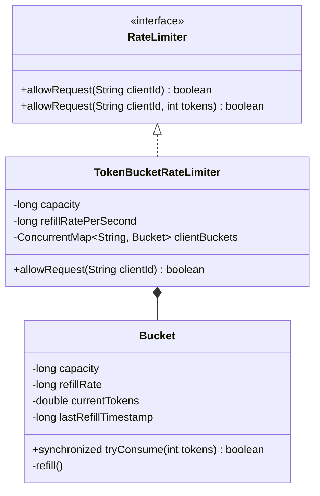

# 02 - Distributed Rate Limiter

## 🎯 Problem Statement
Design a thread-safe Rate Limiter to protect APIs against traffic bursts and abuse:
* `allowRequest(String clientId)`: Returns `true` if the request is permitted within the configured rate window, `false` otherwise.
* Implement the **Token Bucket Algorithm**:
  - A bucket with a fixed capacity $C$ fills at a constant rate of $R$ tokens per second.
  - Each request consumes 1 token.
  - If no tokens remain, the request is rejected ($429$ Too Many Requests).
* Must support multiple distinct clients (`clientId`) concurrently with thread-safe atomicity.

---

## 🏗 Class Diagram

---

## 🚀 Key Implementation Highlights
1. **Strategy Pattern**: Extensible interface allowing drop-in implementations for Leaky Bucket, Sliding Window Log, or Token Bucket.
2. **Lazy Token Refill**: Tokens are calculated lazily based on elapsed time $(\Delta t \times R)$ upon each request, avoiding wasteful background timer threads.
3. **Thread Safety**: Synchronized bucket state transitions per client using `ConcurrentHashMap`.
