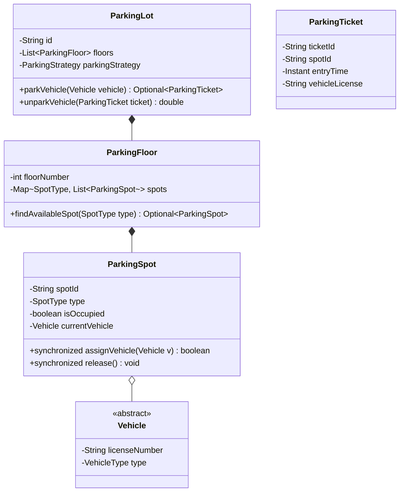

# 03 - Multi-Floor Parking Lot System

## 🎯 Problem Statement
Design an automated parking lot management system:
* Supports multi-floor parking with multiple entry and exit gates.
* Different spot types: `COMPACT` (Bikes/Small cars), `LARGE` (Trucks/SUVs), `ELECTRIC` (EV charging).
* Issues a `ParkingTicket` with entry timestamp, allocated spot, and vehicle license plate upon entry.
* Calculates parking fees at exit based on spot type and duration.
* Must support concurrent entry/exit gate operations without race conditions or double-booking.

---

## 🏗 Class Diagram

---

## 🚀 Key Implementation Highlights
1. **Strategy Pattern**: `ParkingStrategy` interface to easily switch between *Nearest to Entrance*, *Lowest Floor First*, or *Best-Fit* spot allocation.
2. **Factory Pattern**: `VehicleFactory` creates instances of `Car`, `Bike`, `Truck`, and `ElectricCar`.
3. **Thread Safety**: Fine-grained synchronization at the `ParkingSpot` level prevents race conditions when two vehicles attempt to claim the same spot simultaneously.
