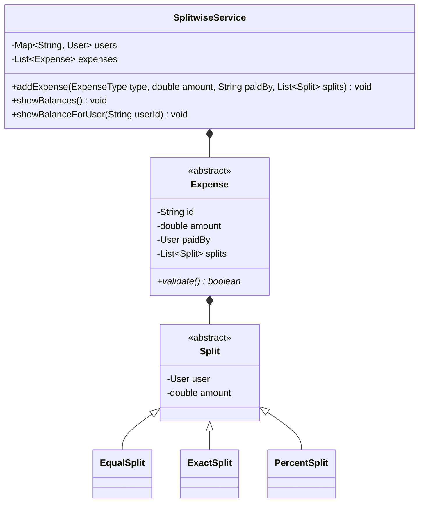

# 04 - Splitwise (Expense Sharing Application)

## 🎯 Problem Statement
Design an expense-sharing application similar to Splitwise:
* Users can add expenses paid by one user and shared among multiple users.
* Supports 3 split types:
  1. **EQUAL**: Amount is divided equally among participants.
  2. **EXACT**: Exact amounts are specified per user (sum must match total).
  3. **PERCENT**: Percentage shares are specified per user (sum must equal 100%).
* Maintains user balance sheets (`User A owes User B $25.00`).
* Calculates simplified debt graphs (debt simplification algorithm).

---

## 🏗 Class Diagram

---

## 🚀 Key Implementation Highlights
1. **Strategy / Polymorphism**: Derived `Split` subclasses enforce mathematical invariants (`PercentSplit` validates 100%, `ExactSplit` validates exact sum).
2. **Double-Entry Ledger**: Balances are updated bidirectionally between debtor and creditor.
3. **Debt Simplification**: Greedy minimum cash flow algorithm using Max-Heap / Min-Heap reduces settlement transactions.
