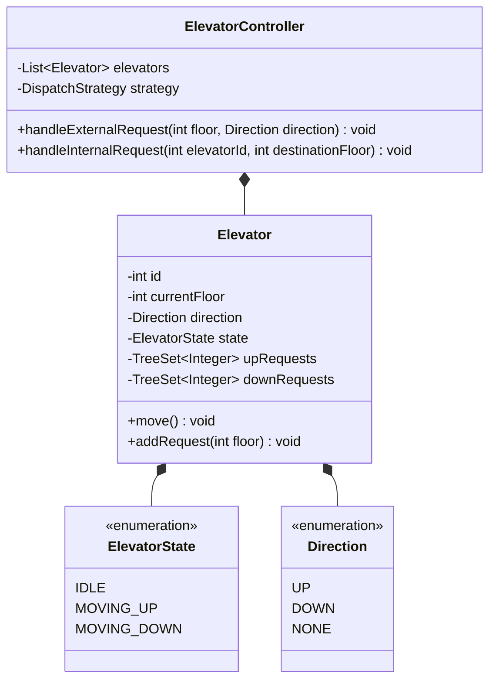

# 05 - Elevator Dispatch System

## 🎯 Problem Statement
Design an elevator control system for an $M$-floor building with $N$ elevators:
* Internal button panel inside the elevator (select destination floor).
* External button panel on each floor (press UP / DOWN).
* Elevator states: `IDLE`, `MOVING_UP`, `MOVING_DOWN`.
* Dispatcher schedules requests to minimize average wait time and passenger travel time.
* Handles edge cases: direction reversals, emergency stops, max capacity limits.

---

## 🏗 Class Diagram

---

## 🚀 Key Implementation Highlights
1. **State Pattern**: Encapsulates state transitions (`IDLE` to `MOVING_UP`, etc.) cleanly.
2. **LOOK / SCAN Elevator Algorithm**: Moves in one direction servicing all requests ahead before reversing, preventing starvation.
3. **Dispatch Strategy**: Pluggable algorithm (`ProximityDispatchStrategy`, `ZoneBasedDispatchStrategy`) to assign the optimal car.
