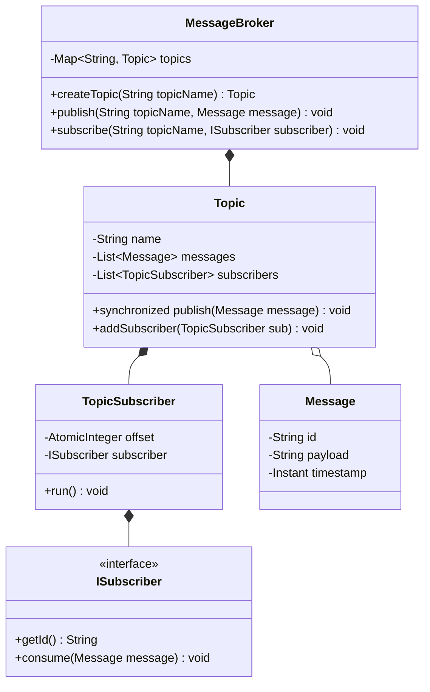

# 06 - In-Memory Pub-Sub Message Broker

## 🎯 Problem Statement
Design an in-memory Pub-Sub Message Broker (mini-Kafka / EventBus):
* Publishers publish messages to named `Topics`.
* Multiple `Subscribers` can subscribe to topics.
* Messages within a topic are strictly ordered and indexed by an offset.
* Each subscriber maintains its own consumed offset independently.
* Supports concurrent message consumption via worker thread pools.

---

## 🏗 Class Diagram

---

## 🚀 Key Implementation Highlights
1. **Observer / Pub-Sub Pattern**: Complete decoupling between message producers and consumers.
2. **Offset-Based Independent Consumption**: Slow consumers do not block fast consumers on the same topic.
3. **Thread Safety**: Atomic offset advancement with synchronized message buffers.
