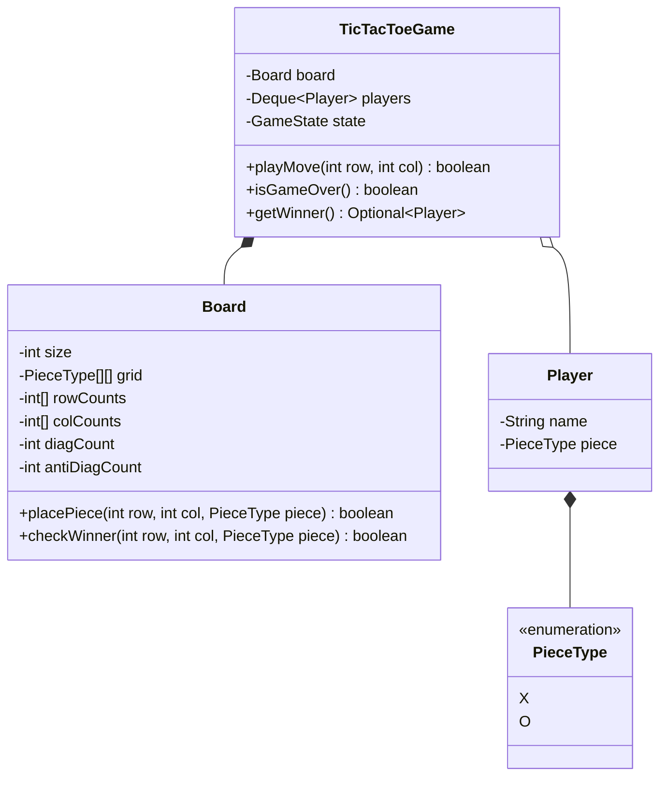

# 07 - Tic-Tac-Toe Game Loop

## 🎯 Problem Statement
Design an $N \times N$ board turn-based Tic-Tac-Toe game supporting $M$ players:
* Configurable board dimension ($N \ge 3$).
* Configurable players with distinct symbols (e.g. `X`, `O`, `#`, `@`).
* Turn management queue ensuring fair alternating moves.
* $O(1)$ move validation and winner detection using row, column, and diagonal counters.
* Handles draw conditions when all cells are exhausted.

---

## 🏗 Class Diagram

---

## 🚀 Key Implementation Highlights
1. **$O(1)$ Winner Detection**: Instead of checking the entire board ($O(N^2)$), maintains integer running counts for each row, column, and diagonals.
2. **Turn Queue**: Circular `Deque<Player>` automatically rotates players after every legal move.
3. **Immutability & Encapsulation**: Board cells cannot be overwritten once set.
