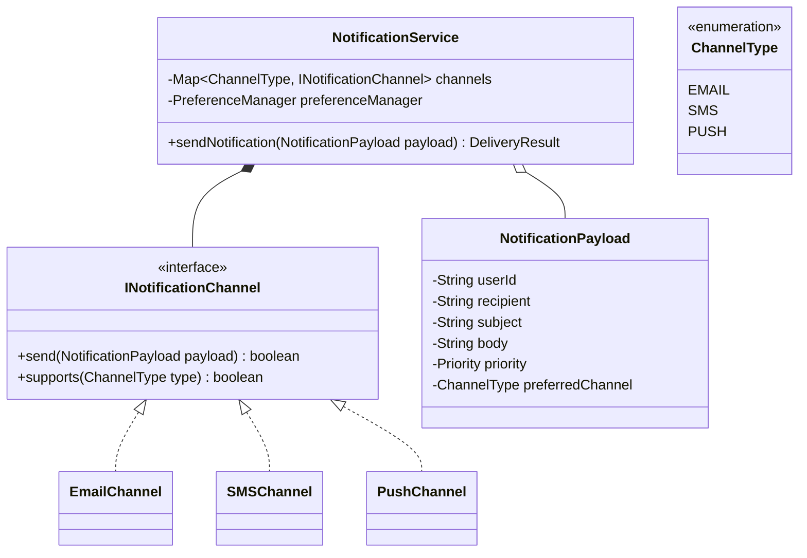

# 08 - Multi-Channel Notification Engine

## 🎯 Problem Statement
Design an extensible, resilient notification dispatch service:
* Delivers notifications across multiple channels: `EMAIL`, `SMS`, `PUSH_NOTIFICATION`.
* User notification preferences (e.g. User A receives SMS for urgent security alerts, Email for daily digests).
* Automatic fallback routing (if SMS delivery fails, fallback to Push or Email).
* Priority queuing (`HIGH`, `MEDIUM`, `LOW`) with rate limiting per user to prevent notification fatigue.
* Template engine support for personalized notification rendering.

---

## 🏗 Class Diagram

---

## 🚀 Key Implementation Highlights
1. **Strategy & Factory Pattern**: Decoupled `INotificationChannel` implementations with a channel factory.
2. **Chain of Responsibility**: Automatic fallback chain if the primary delivery channel throws a transient gateway error.
3. **Template Rendering**: Parameterized message interpolation before delivery.
