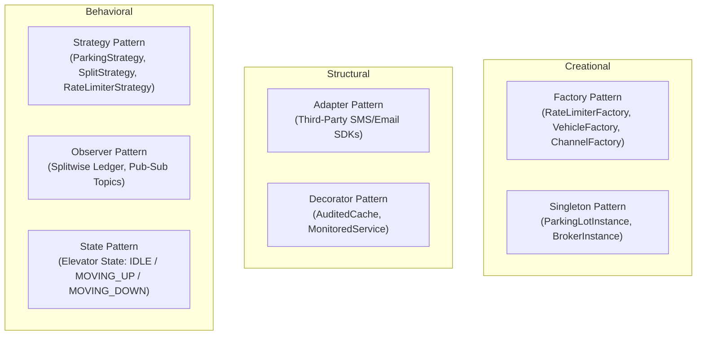

# Low-Level Design Vault 🏛️

[](https://openjdk.org/projects/jdk/21/)
[](https://maven.apache.org/)
[](https://junit.org/junit5/)
[](#design-patterns-index)
[](LICENSE)

A curated, production-grade repository of **Low-Level Design (LLD)** and **Machine Coding** solutions implemented in **Java 21**. 

Each problem strictly adheres to **SOLID design principles**, standard **Gang of Four (GoF) design patterns**, thread safety for concurrent access, and modular unit tests with **JUnit 5**.

---

## 🎯 Design Principles Applied
Every problem in this vault is engineered using first-principles object-oriented design:
* **Single Responsibility Principle (SRP)**: Each class is decoupled and has one primary responsibility.
* **Open/Closed Principle (OCP)**: Logic is open for extension via interfaces/abstract classes without modifying existing code.
* **Liskov Substitution Principle (LSP)**: Derived types strictly substitute base abstractions without breaking client contracts.
* **Interface Segregation Principle (ISP)**: Lean, client-specific interfaces over bloated god-interfaces.
* **Dependency Inversion Principle (DIP)**: High-level business orchestrators depend upon interfaces, not concrete classes.

---

## 📚 Problem Catalog

| # | System / Problem | Key Design Patterns Used | Core Technical Highlights | Directory |
| :-: | :--- | :--- | :--- | :--- |
| **01** | **In-Memory LRU Cache** | Doubly-Linked List + HashMap | $O(1)$ reads/writes, thread-safe `ReentrantReadWriteLock`, Generic types `<K, V>` | [`01-in-memory-lru-cache`](01-in-memory-lru-cache/) |
| **02** | **Distributed Rate Limiter** | Strategy, Factory | Token Bucket, Leaky Bucket, Sliding Window Log, thread-safe atomic counters | [`02-rate-limiter`](02-rate-limiter/) |
| **03** | **Multi-Floor Parking Lot** | Strategy, Factory, Singleton | Dynamic spot allocation (Compact, Large, EV), hourly billing calculator, concurrency locks | [`03-parking-lot`](03-parking-lot/) |
| **04** | **Splitwise (Expense Sharing)** | Strategy, Observer | Equal split, Exact amount split, Percentage split, balance sheet simplification | [`04-splitwise-expense-sharing`](04-splitwise-expense-sharing/) |
| **05** | **Elevator Dispatch System** | State, Strategy | Internal/External dispatch algorithms, Directional SCAN (LOOK) scheduling, state transitions | [`05-elevator-system`](05-elevator-system/) |
| **06** | **In-Memory Pub-Sub Broker** | Observer, Producer-Consumer | Topic partitioning, offset tracking, concurrent consumer groups with `BlockingQueue` | [`06-in-memory-pubsub-broker`](06-in-memory-pubsub-broker/) |
| **07** | **Tic-Tac-Toe Game Loop** | Strategy, Factory | Configurable $N \times N$ board, modular piece representations, turn-based validation | [`07-tic-tac-toe`](07-tic-tac-toe/) |
| **08** | **Multi-Channel Notification Engine** | Factory, Strategy, Observer | Email, SMS, Push providers with automatic retry fallback policies and priority queues | [`08-notification-service`](08-notification-service/) |

---

## 🧩 Design Patterns Reference Index



---

## 🛠 Project Structure

Each problem is organized as an independent, self-contained Maven module:
```text
problem-name/
├── pom.xml                        # Module dependencies & configuration
├── README.md                      # Problem requirements, API specs & Mermaid diagram
├── src/main/java/com/lld/         # Implementation code
│   ├── model/                     # Domain entities & POJOs
│   ├── strategy/                  # Algorithmic strategy interfaces & implementations
│   └── service/                   # Main business orchestration service
└── src/test/java/com/lld/         # JUnit 5 unit & integration tests
```

---

## 🧪 Running Tests Across All Modules

Compile and execute the test suites across all modules in one command:
```bash
# Run tests across all modules
mvn clean test

# Test a specific module
mvn test -pl 01-in-memory-lru-cache
```

---

## 📜 License
Distributed under the MIT License. See [LICENSE](LICENSE) for details.
